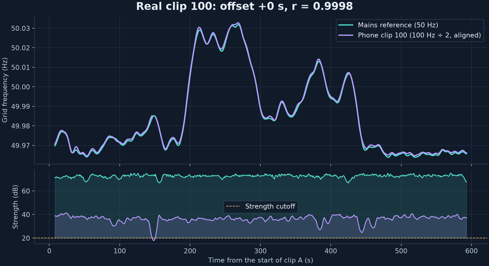
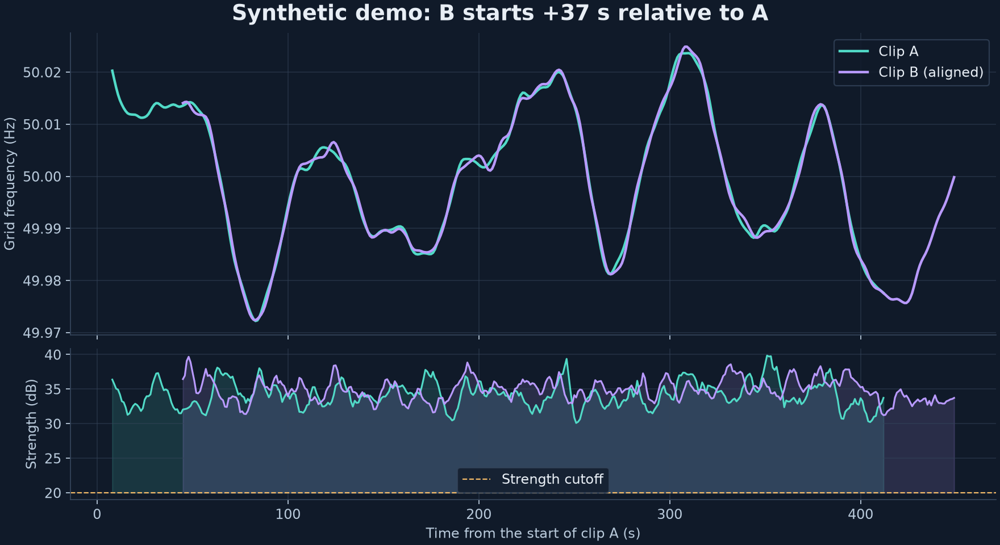

# grid-clock

> Compare audio recordings through the hum of the power grid.

[](https://github.com/Guinerve/grid-clock/actions/workflows/ci.yml)




**Status:** v0.2. Tested on 130 real phone and recorder clips. The two-location
clip-to-clip test has not been run yet. No absolute timestamps.

Mains-powered devices can produce a faint hum in microphone recordings. Grid
frequency drifts slightly over time. Recordings from the same synchronous grid
can share that drift pattern. This technique is called Electrical Network
Frequency (ENF) analysis.

`grid-clock` extracts the pattern and estimates the relative start time of two
clips. It does not give an absolute timestamp. That needs a dated reference
log, and none is integrated or validated.

## Safety

Use acoustic or electromagnetic pickup from normal, enclosed equipment only.
A laptop on its charger, a fridge, or a desk lamp may produce usable hum.
**Never connect a microphone, probe, cable, or circuit directly to mains.**

## Run the demo

Install [uv](https://docs.astral.sh/uv/). Use Python 3.11 or later.

```bash
git clone https://github.com/Guinerve/grid-clock.git
cd grid-clock
uv run grid-clock demo
```

`uv` installs the dependencies on the first run. The demo does not need
`ffmpeg`, a microphone, or a reference dataset.

The demo creates two seven-minute synthetic WAV clips with independent noise.
Clip B starts 37 seconds after clip A. The command writes these files to
`output/demo/`:

- `a.wav`, `b.wav`: generated audio, not real grid recordings.
- `a.trace.csv`, `b.trace.csv`: frequency, strength, and valid-frame flags.
- `match.png`: aligned traces and their signal strength.
- `match.json`: measured offset, scores, settings, and known synthetic truth.

In the local run it recovered `+37 s` with a correlation of `0.9978`. The
largest frequency error was `0.0025 Hz`. Add `--force` to replace existing
demo audio, or use `--output <directory>`.



## Use your own recordings

```bash
uv run grid-clock trace clip.wav --harmonic 2 --output output/clip
uv run grid-clock match a.m4a b.m4a --harmonic 2 --output output/pair
```

`trace` writes `trace.csv`, `trace.png`, and `summary.json`. When a candidate
can be scored, `match` writes `a.trace.csv`, `b.trace.csv`, `match.png`, and
`match.json`, including rejected candidates. Repeated runs replace files in the
output directory. A failed run can leave older files in place, so check the
exit code.

**Start with `--harmonic 2`.** Phone microphones usually filter out 50 Hz. In
the real-recording benchmark, the 100 Hz harmonic gave usable traces and the
fundamental gave none. Use `--nominal 60` on a 60 Hz grid.

**Record at least 8 minutes.** A match needs 300 s of valid, overlapping hum by
default, so each clip needs at least 315 s even at zero offset. Shorter
overlaps produced many false matches on real data.

WAV and FLAC use `soundfile`. M4A/AAC and other formats need `ffmpeg` on
`PATH`, for example `brew install ffmpeg` or `sudo apt-get install ffmpeg`.

The loader picks the channel with the highest RMS level and does not average
channels, since opposite-phase hum could cancel. Use `--channel 1` to choose
the second channel.

A positive offset means B started later than A: `+37` means `a[37 s]` aligns
with `b[0 s]`. The offset resolution is the trace hop, one second by default.

| Option | Default | Meaning |
| --- | --- | --- |
| `--nominal` | `50` | Grid frequency: `50` or `60` Hz |
| `--harmonic` | `1` | Track the fundamental (`1`) or second harmonic (`2`) |
| `--window` | `16` | Analysis window in seconds; minimum `4` |
| `--hop` | `1` | Trace step in seconds; positive and no larger than the window |
| `--min-strength` | `20` | Minimum peak-to-nearby-noise ratio in dB |
| `--channel` | Highest RMS | Zero-based audio channel; applies to every clip |
| `--min-overlap` | `300` | Minimum valid paired seconds; `match` and `validate` |
| `--max-offset` | Full range | Search within ±this many seconds; `match` and `validate` |

Window and hop must be multiples of 0.002 seconds. `demo` uses fixed settings.

Exit codes: `0` means usable trace frames, an accepted match, or a passed
validation. `1` means no usable frames, a rejected match, or a failed
validation. `2` means invalid input, a decode failure, or not enough changing
hum to compare.

## Test it with two locations

`grid-clock validate` checks the matcher against start times that people
logged themselves. List the recordings in a JSON manifest:

```json
{
  "recordings": [
    {"id": "home", "path": "home.m4a", "location": "home",
     "logged_start": "2026-10-18T19:00:04+11:00", "start_uncertainty_s": 2},
    {"id": "office", "path": "office.m4a", "location": "office",
     "logged_start": "2026-10-18T19:00:31+11:00", "start_uncertainty_s": 2},
    {"id": "control", "path": "control.m4a", "location": "home",
     "logged_start": "2026-10-19T08:15:00+11:00", "start_uncertainty_s": 2}
  ]
}
```

```bash
uv run grid-clock validate manifest.json --harmonic 2 --output output/two-location
```

Pairs whose logged times overlap are scored against the logged difference.
Pairs logged at different times are negative controls. The command reports
offset errors and false matches in `validation.json` and `pairs.csv`. It
uses logged times only as differences and never writes them out.

Follow [docs/two-location-protocol.md](docs/two-location-protocol.md) for the
recording steps. A full example is in
[examples/two-location.manifest.json](examples/two-location.manifest.json).

## How I know it's right

Full details and commands are in [docs/validation.md](docs/validation.md).

**Real recordings.** The public [ENF-WHU](https://github.com/ghua-ac/ENF-WHU-Dataset)
dataset pairs 130 phone and recorder clips with simultaneous mains-frequency
logs. Clips from different days act as negative controls. Thresholds were
chosen on the odd-numbered clips and checked on the even-numbered clips.

| Test (100 Hz harmonic) | Result |
| --- | --- |
| Clip vs simultaneous mains log | 44 of 130 correct, 0 wrong offsets, 82 too weak to score |
| Offset error of accepted pairs | median 2 s, max 4 s |
| Held-out half only | 20 of 65 correct, 0 wrong offsets |
| Different-day controls | 0 false matches in 6,598 scored pairs |
| Clip searched across a 24-hour log | 41 of 113 found within 4 s, 0 wrong offsets |
| 50 Hz fundamental | 0 of 130 clips usable |

Version 0.1 used a 60 s overlap and r ≥ 0.9. On the same data, it accepted
1,815 of 7,495 scored different-day controls. Version 0.2 needs 300 s and
r ≥ 0.97.

**Not yet tested.** Two microphone recordings made at the same time in two
places. Every ENF-WHU pair compares a microphone with a direct mains log. All
clips come from one city on one grid.

**Synthetic.** `uv run pytest` covers known drift in noise, both harmonics,
50 and 60 Hz grids, positive and negative offsets, missing frames, unrelated
and periodic traces, M4A decoding, manifest checks, and scoring rules.

## How it works

1. Decode one audio channel and resample it to 500 Hz with anti-alias filtering.
2. Band-pass around the selected fundamental or second harmonic.
3. Apply a Hann-window STFT with 16-second windows and one-second steps, in
   small batches to bound memory.
4. Search within ±0.2 Hz of the nominal frequency. A zero-padded FFT and
   quadratic interpolation of log power estimate the peak.
5. Divide harmonic estimates by the harmonic number, so traces always show
   grid frequency. Trace times are window centres.
6. Mark a frame valid when its peak-to-nearby-noise ratio is at least 20 dB.
   Invalid frequencies are blank in CSV output.
7. Compute Pearson correlation at every offset over paired valid frames only.

An offset is eligible with at least 300 valid paired seconds, 80% valid
coverage in the overlap, and at least 0.002 Hz drift standard deviation on
each side. The best eligible offset is accepted when r ≥ 0.97 and it beats the
best competitor more than one window away by at least 0.05. If no competitor is
eligible, `competing_correlation` is `null` and the result says uniqueness was
not assessed. A restricted `--max-offset` can hide other plausible offsets.

The strength band in the plot is a screening aid, not an error band or a
probability. Adjacent windows overlap and are not independent. The thresholds
are heuristics, not forensic confidence levels.

## Limits

- Recordings need detectable hum. Many microphones remove low frequencies, and
  battery-powered setups may pick up nothing. Most real clips were too weak to
  score.
- A constant tone carries no time information. An unrelated oscillator can
  look like hum, so a strong tone is not proof of grid origin.
- Repeating or slowly drifting patterns can create several plausible offsets.
  Searching many offsets increases the chance of a false match.
- Compression, noise, local interference, and sample-clock drift reduce
  accuracy. Clock-drift correction and harmonic fusion are not implemented.
- Files are decoded into memory. This is not a streaming recorder.
- No dated reference source is integrated, so there are no absolute
  timestamps. Nothing here has been validated for forensic use.

## Development

```bash
uv sync --locked
uv run pytest
uv run ruff check .
uv run ruff format --check .
uv build
```

CI runs lint, formatting, tests, and the demo on Python 3.11–3.13. The real
benchmark needs about 3.3 GB of downloads and is run by hand:

```bash
uv run python scripts/fetch_enf_whu.py --one-day
uv run python scripts/benchmark_enf_whu.py --one-day
```

## Next steps

- Run the two-location test with a different-time control and add the result
  to [docs/validation.md](docs/validation.md).
- Measure sensitivity to compression, interference, and sample-clock drift.
- Check whether a dated reference source, such as AEMO data, has the resolution
  and coverage for absolute-time matching. Absolute timestamps stay out until
  one works.

## Contributing

Run the development checks before opening a pull request. For a bug report,
include the command, Python version, audio format, sample rate, and error
output. Use a synthetic reproducer when possible. Do not upload private
recordings.

## Licence

MIT. See [LICENSE](LICENSE). The ENF-WHU dataset is MIT-licensed by its
authors. It is downloaded on demand, not redistributed here.
